# RoboHarness

**Zero-shot video-to-humanoid skill forging for the Hiwonder TonyPi, powered by a dual-client Gemini 4 native hardware harness.**

Built clean-room for the **Gemini 4 NYC Hackathon** (*Problem Statement One: "5 Sigma"* + *Best Use of Managed Agents*), RoboHarness watches **any** short human video — a live 5-second webcam recording of a judge or an uploaded MP4 (e.g., a Fortnite dance) — analyzes it with **Agentic Video Processing** (`processing="agentic"`), retargets and physics-verifies 16-DOF trajectories inside a forked Google Managed Agent sandbox (`gemini-4-neon` with automatic escalation to `gemini-4-carbon`), gates safety and fidelity with the **0-output-token Decisions API** (`confidence >= 0.75` and `is_physically_safe >= 0.75`), saves SHA-256 signed reusable skills, and executes live on a physical TonyPi robot exclusively over **Streamable HTTP MCP**.

---

## Architecture

```mermaid
flowchart LR
    In["5s Webcam / MP4 Video"] --> Files["Files API Upload<br/>processing='agentic'"]
    Files --> H["v1: gemini-4-hydrogen<br/>Pose Extraction (medium)<br/>+ debug-video (high)"]
    Cam["TonyPi perceive() Frame"] --> ER["v1beta: gemini-robotics-er-2-preview<br/>Workspace & Edge Check (medium)"]
    H --> Forge["v1beta: Managed Agent Skill Forge<br/>roboharness-skill-forge (gemini-4-neon)<br/>2-Fail / --deep Escalation -> gemini-4-carbon<br/>remote fork OR GEMINI_ENVIRONMENT_ID"]
    ER --> Forge
    Forge --> Gate["v1beta: gemini-decision-1<br/>0-Output-Token Multimodal Gate<br/>(confidence >= 0.75 AND safe >= 0.75)"]
    Gate -- "repair_in_forge" --> Forge
    Gate -- "adapt_upper_body_only" --> Proj["Upper-Body Safe Projection"]
    Gate -- "refuse_impossible / escalate_human" --> Stop["Safe Stop (0 Servo Commands)"]
    Gate -- "execute_and_save" --> Latch["Deterministic Non-LLM Safety Latches<br/>(>=10.9V, <70C, <30 deg, 0 clip)"]
    Proj --> Latch
    Latch --> Store["Signed Skill Library<br/>skills/&lt;name&gt;.json (SHA-256)"]
    Store --> Reflex["v1: gemini-4-hydrogen (medium)<br/>Live Reflex Speech"]
    Reflex --> MCP["Streamable HTTP MCP Boundary<br/>TONYPI_MCP_URL (127.0.0.1:8765/mcp)"]
    MCP --> Robot["Hiwonder TonyPi / MuJoCo 4.0.1 Studio MCP / Mock"]
    Robot -. "Post-Run Frame + IMU" .-> Gate
    Robot -. "3D Web Viewer + SimHistory" .-> Studio["MuJoCo 4.0.1 Studio<br/>http://localhost:8080/<br/>(Filament/WASM + Dear ImGui)"]
    Latch -. "Live Events + Viewport" .-> SSE["Minimal SSE Telemetry Strip<br/>127.0.0.1:8770"]
```



---

## Dual-Client & 4-Model Responsibility Matrix

RoboHarness strictly separates stable `v1` and `v1beta` SDK clients in [`src/roboharness/models.py`](src/roboharness/models.py) (`DualGenAIClients`), with zero forbidden sampling/caching/token-cap overrides (`temperature`, `top_p`, `top_k`, `cachedContents`, `max_output_tokens`, `max_total_tokens`) and strictly valid `thinking_level` values (`medium` / `high` on Interactions calls, never `minimal`):

| Model / Agent | SDK Client | Role | Mode / `thinking_level` | Module |
| :--- | :--- | :--- | :--- | :--- |
| **`gemini-4-hydrogen`** | Stable **`v1`** (`make_v1_client`) | Agentic video (`processing="agentic"`) & text beat-synced 6–14 keyframe `PoseSequence` extraction, impossible-move flagging, crisp live reflex speech, and post-trial video debugging (`roboharness debug-video`) | `"medium"` (extract/reflex), `"high"` (`debug-video`) | [`src/roboharness/motion_extractor.py`](src/roboharness/motion_extractor.py) |
| **Managed Agent `roboharness-skill-forge`** (`antigravity-preview-09-2026` + **`gemini-4-neon`**, escalating to **`gemini-4-carbon`** via `roboharness-skill-forge-carbon`) | **`v1beta`** (`make_beta_client`) | Sandboxed 16-DOF servo retargeting, grounded lower-body adaptation, and iterative Python physics verification; escalates to `gemini-4-carbon` after 2 failed Neon kinematics verifications or when `--deep` is set | Locked at `agents.create(...)`; zero `max_total_tokens` cap | [`src/roboharness/managed_forge.py`](src/roboharness/managed_forge.py), [`agent_bundle/`](agent_bundle/) |
| **`gemini-decision-1`** | **`v1beta`** (`make_beta_client`) | 0-output-token parallel 4-question gate (`is_physically_safe`, `needs_lower_body_adaptation`, `move_fidelity` 0–3, `route` with `"other"` fallback — never `"none_of_the_above"`) for pre-execution routing and post-run fidelity scoring | **0 output tokens**; auto-branch requires `confidence >= 0.75` **AND** `is_physically_safe >= 0.75` | [`src/roboharness/decision_gate.py`](src/roboharness/decision_gate.py) |
| **`gemini-robotics-er-2-preview`** | **`v1beta`** (`make_beta_client`) | Live spatial workspace framing check on `perceive()` camera JPEGs (`centered_on_table`, `workspace_clear`, `robot_bbox_norm`, `clearance_margin`) | `"medium"` | [`src/roboharness/spatial.py`](src/roboharness/spatial.py) |

---

## Managed Agent Skill Forge: Environment Forking, Self-Hosted Docker, & Carbon Escalation

1. **Hosted Remote Forking (Default `environment="remote"`)**:
   - `roboharness forge-setup` runs a one-time bootstrap interaction on `antigravity-preview-09-2026` staging [`agent_bundle/.agents/AGENTS.md`](agent_bundle/.agents/AGENTS.md), [`agent_bundle/.agents/skills/kinematics-verifier/SKILL.md`](agent_bundle/.agents/skills/kinematics-verifier/SKILL.md), and [`agent_bundle/kinematics_verify.py`](agent_bundle/kinematics_verify.py).
   - Once `python3 /workspace/kinematics_verify.py --self-test` exits `0`, RoboHarness creates persistent custom agent `roboharness-skill-forge` (`gemini-4-neon`) with `base_environment=bootstrap.environment_id`. Passing `--deep` also pre-stages `roboharness-skill-forge-carbon` (`gemini-4-carbon`).
2. **Self-Hosted Docker / MuJoCo Environment (`GEMINI_ENVIRONMENT_ID`)**:
   - Set `GEMINI_ENVIRONMENT_ID` to route Managed Agent interactions directly to your self-hosted Docker/MuJoCo environment (`environment=settings.gemini_environment_id`, omitting hosted-only `sources` and `network.allowlist`).
3. **Automatic Neon -> Carbon Escalation**:
   - Standard runs execute on `gemini-4-neon` up to 2 attempts, feeding exact local kinematics violations into attempt 2. If `gemini-4-neon` fails deterministic kinematics verification twice — or if you pass `--deep` — RoboHarness escalates directly to `gemini-4-carbon` (`roboharness-skill-forge-carbon`) with zero `max_total_tokens` cap.
4. **Optional Remote MCP**: When `TONYPI_REMOTE_MCP_URL` is configured and `--remote-mcp` is passed, the Managed Agent receives the remote MCP tool named `tonypi_mcp` (`^[a-z0-9_-]+$`).

---

## Deterministic Hardware Safety Latches & Clean-Room Boundary

LLMs never command servos without passing deterministic, non-LLM physics and hardware checks ([`src/roboharness/safety.py`](src/roboharness/safety.py)):

| Latch | Hard Threshold | Enforcement Point |
| :--- | :--- | :--- |
| **Battery Voltage** | `battery_v >= 10.9 V` | Pre-flight + between every frame in `mcp_client.py` |
| **Servo Temperature** | `max_servo_temp_c < 70.0 °C` | Pre-flight + inter-frame watchdog |
| **Peak Torso Tilt & CoM** | `peak_torso_tilt_deg < 30.0°` | Sandbox `kinematics_verify.py` + local defense-in-depth + live IMU |
| **Joint-Limit Clipping** | `joint_clipping_count == 0` (all 16 servos) | Sandbox + local defense-in-depth before MCP dispatch |
| **Servo Slew & Timing** | `<= 900 pulses/sec`, `duration_ms >= 80 ms` | Sandbox + local defense-in-depth |
| **Artifact Integrity** | Canonical SHA-256 signature verified on load/save | [`src/roboharness/skill_store.py`](src/roboharness/skill_store.py) |
| **Decisions Auto-Branch Gate** | `confidence >= 0.75` **AND** `is_physically_safe >= 0.75` | Below threshold escalates to Managed Forge repair or human approval (0 servos moved) |

### Clean-Room & Live-Mode Boundary
- **Net-New Implementation**: All code in this repository is written from scratch.
- **External Hardware Driver Only**: [`markeljan/tonypi`](https://github.com/markeljan/tonypi) is treated strictly as an unchanged external MIT hardware driver reached **only** over Streamable HTTP MCP (`TONYPI_MCP_URL`, default `http://127.0.0.1:8765/mcp`).
- **Zero Mocked Live Paths**: Passing `--mock` only swaps in [`MockTonypiMCPServer`](src/roboharness/mock_mcp.py) for hardware; Gemini API calls remain live and fail loudly if `GEMINI_API_KEY` is unset. Offline CI/tests require passing `--offline` explicitly.
- **MuJoCo 4.0.1 + MuJoCo Studio**: Run `uv sync --extra sim` and `uv run roboharness sim-server` to launch our clean-room [`MujocoTonypiMCPServer`](src/roboharness/mujoco_mcp_server.py) (`http://127.0.0.1:8765/mcp`) paired with **MuJoCo 4.0.1 Studio** (`--studio-gfx web` at `http://localhost:8080/` or `--studio-gfx native`) featuring Filament/WASM PBR rendering, `SimHistory` timeline scrubbing, and our custom Dear ImGui **"RoboHarness Telemetry"** overlay ([`src/roboharness/studio_plugin.py`](src/roboharness/studio_plugin.py)), plus live `/stream.mjpeg` & `/frame.jpg`.
- **No Streamlit**: Passing `--ui` launches a minimal stdlib SSE telemetry strip + live camera viewport at `http://127.0.0.1:8770` ([`src/roboharness/telemetry_sse.py`](src/roboharness/telemetry_sse.py)) designed to stay visually subordinate to the physical robot.

---

## CLI Quickstart

### 1. Install & Configure
```bash
uv sync --extra sim
export GEMINI_API_KEY="your-gemini-api-key"
# Optional: TonyPi MCP server (defaults to http://127.0.0.1:8765/mcp)
export TONYPI_MCP_URL="http://127.0.0.1:8765/mcp"
# Optional: self-hosted Docker/MuJoCo sandbox environment ID (defaults to "remote")
export GEMINI_ENVIRONMENT_ID="env-..."
```
*(A local `.env` file in the repo root is auto-loaded by `RoboHarnessSettings.from_env()` without overriding exported shell variables.)*

### 2. Optional: Launch Clean-Room MuJoCo 4.0.1 Studio + MCP Simulator
```bash
# Starts Streamable HTTP MCP (:8765/mcp), live MJPEG (:8765/stream.mjpeg), and
# MuJoCo 4.0.1 Studio 3D Web Viewer (http://localhost:8080/) with SimHistory + RoboHarness Telemetry panel
uv run roboharness sim-server --studio-gfx web --studio-port 8080 --open-browser

# Or native Studio window (`--studio-gfx native`) / headless (`--studio-gfx none`)
uv run python -m roboharness.mujoco_mcp_server --studio-gfx web --studio-port 8080
```

### 3. Pre-Flight Check & Managed Agent Setup
```bash
# Verify v1 + v1beta Gemini models & TONYPI_MCP_URL (add --mock if hardware is offline)
uv run roboharness check

# Pre-stage & fork "roboharness-skill-forge" (add --deep to also warm gemini-4-carbon)
uv run roboharness forge-setup --deep
```

### 4. Live Demo: Mimic Any Video, Replay, & Debug Trials
```bash
# Live 5-second webcam recording of a judge + minimal SSE telemetry strip on :8770
uv run roboharness mimic --webcam 5 --name judge_wave --ui

# Upload any short MP4 (e.g., a Fortnite dance); add --deep for direct gemini-4-carbon forging
uv run roboharness mimic --video clip.mp4 --name floss --deep

# Replay any saved, SHA-256-verified skill on demand
uv run roboharness run floss

# Inspect saved skills, peak tilt, clipping count, fidelity score, and SHA-256 hashes
uv run roboharness list

# Diagnose a recorded robot trial using Agentic Video Processing (thinking_level="high")
uv run roboharness debug-video --video trial.mp4 --name floss --expected "Stable hips and alternating arm swing"
```

### 5. Fast Offline CI & Benchmark (Zero Hardware, Zero API Keys)
```bash
# Run the full offline test suite
uv run pytest -q

# Explicit offline smoke test against MockTonypiMCPServer
uv run roboharness mimic --video clip.mp4 --name demo_wave --mock --offline
```

---

## 5 Sigma Proof Engine & Governance

- **[`PROOF_IT_WORKS.md`](PROOF_IT_WORKS.md)** — Quantitative 12-scenario evaluation across 4 categories (3 Dances, 3 Gestures, 3 Asymmetric Poses, 3 Impossible Moves + sim-to-real `1.45x` table-slip stress tests) comparing **Baseline A** (single-shot `gemini-4-hydrogen`) against **Full RoboHarness**, complete with an **Honest Failure Ledger**.
  ```bash
  # Deterministic offline 12-scenario benchmark (< 1s)
  uv run python benchmarks/eval_5sigma.py --mode offline --output PROOF_IT_WORKS.md --json-out benchmarks/eval_results.json

  # Live 12-scenario benchmark against real Gemini 4 APIs (optional --deep for Carbon)
  uv run python benchmarks/eval_5sigma.py --mode live --output PROOF_IT_WORKS.md --json-out benchmarks/eval_results.json
  ```
- **[`GEMINI.md`](GEMINI.md)** — Clean-Room Constitution, Dual-Client (`v1` + `v1beta`) SDK invariants, Agentic Video Processing, Managed Agent configuration & Carbon escalation rules, Decisions API `0.75` thresholds, and hardware safety latches (continuously enforced by [`tests/test_sdk_invariants.py`](tests/test_sdk_invariants.py)).

---

## Repository Map

```text
roboharness/
├── GEMINI.md                        # Clean-room & Gemini 4 Dual-Client invariants
├── PROOF_IT_WORKS.md                # 12-scenario 5 Sigma benchmark + Failure Ledger
├── agent_bundle/                    # Staged into Managed Agent forked Ubuntu sandbox
│   ├── .agents/AGENTS.md
│   ├── .agents/skills/kinematics-verifier/SKILL.md
│   └── kinematics_verify.py
├── benchmarks/
│   ├── scenarios.py                 # 12 unseen scenarios (dance/gesture/asymmetric/impossible)
│   └── eval_5sigma.py               # Offline & live Baseline A vs RoboHarness proof engine
├── src/roboharness/
│   ├── cli.py                       # Typer + Rich CLI (`roboharness`, incl. `debug-video`)
│   ├── config.py                    # Safety & 0.75 decision thresholds, model IDs, .env loader
│   ├── models.py                    # DualGenAIClients (v1 + v1beta), Agentic Video upload, param guards
│   ├── genai_client.py              # Re-exports models.py helpers for backwards compatibility
│   ├── schemas.py                   # Pydantic v2 models + 16-DOF TonyPi joint specs
│   ├── safety.py                    # Non-LLM safety latches, CoM model, SHA-256 signing
│   ├── motion_extractor.py          # v1 gemini-4-hydrogen agentic extraction, debug_trial_video, reflex speech
│   ├── spatial.py                   # v1beta gemini-robotics-er-2-preview tabletop framing check
│   ├── managed_forge.py             # v1beta Managed Agent setup, env forking / GEMINI_ENVIRONMENT_ID, Neon->Carbon
│   ├── decision_gate.py             # v1beta 0-output-token gemini-decision-1 gates (>=0.75)
│   ├── skill_store.py               # Atomic SHA-256 verified skills/<name>.json library
│   ├── mcp_client.py                # Streamable HTTP MCP JSON-RPC 2.0 client
│   ├── mujoco_mcp_server.py         # Clean-room MuJoCo 4.0.1 Studio + Streamable HTTP MCP server
│   ├── studio_plugin.py             # Dear ImGui "RoboHarness Telemetry" plugin for MuJoCo 4 Studio
│   ├── mock_mcp.py                  # Deterministic offline MockTonypiMCPServer + fault injection
│   ├── capture.py                   # macOS avfoundation webcam capture & preview frames
│   ├── telemetry_sse.py             # Minimal stdlib SSE status strip + live viewport (127.0.0.1:8770)
│   └── pipeline.py                  # End-to-end MimicPipeline + pre-flight checks
└── tests/                           # Fast offline unit, e2e, CLI, eval, and AST invariant tests
```
