# RoboHarness

**Zero-shot video-to-humanoid skill forging for the Hiwonder TonyPi, powered by a 4-model Gemini 4 native hardware harness.**

Built clean-room for the **Gemini 4 NYC Hackathon** (*Problem Statement One: "5 Sigma"* + *Best Use of Managed Agents*), RoboHarness watches **any** short human video — a live 5-second webcam recording of a judge or an uploaded MP4 (e.g., a Fortnite dance) — extracts beat-synced motion, retargets and physics-verifies 16-DOF trajectories inside a forked Google Managed Agent Ubuntu sandbox, gates safety and fidelity with the **0-output-token Decisions API**, saves SHA-256 signed reusable skills, and executes live on a physical TonyPi robot exclusively over **Streamable HTTP MCP**.

---

## Architecture

```mermaid
flowchart LR
    In["5s Webcam / MP4 Video"] --> H["gemini-4-hydrogen<br/>Pose Extraction (medium)"]
    Cam["TonyPi perceive() Frame"] --> ER["gemini-robotics-er-2-preview<br/>Workspace & Edge Check"]
    H --> Forge["Managed Agent: roboharness-skill-forge<br/>antigravity-preview-09-2026 + gemini-4-neon<br/>Forked Ubuntu Sandbox + kinematics_verify.py"]
    ER --> Forge
    Forge --> Gate["gemini-decision-1<br/>0-Output-Token Multimodal Gate<br/>(confidence >= 0.70)"]
    Gate -- "repair_in_forge (1 retry)" --> Forge
    Gate -- "adapt_upper_body_only" --> Proj["Upper-Body Safe Projection"]
    Gate -- "refuse_impossible / escalate_human" --> Stop["Safe Stop (0 Servo Commands)"]
    Gate -- "execute_and_save" --> Latch["Deterministic Non-LLM Safety Latches<br/>(>=10.9V, <70C, <30 deg, 0 clip)"]
    Proj --> Latch
    Latch --> Store["Signed Skill Library<br/>skills/&lt;name&gt;.json (SHA-256)"]
    Store --> Reflex["gemini-4-hydrogen (low)<br/>Live Reflex Speech"]
    Reflex --> MCP["Streamable HTTP MCP Boundary<br/>TONYPI_MCP_URL (127.0.0.1:8765/mcp)"]
    MCP --> Robot["Hiwonder TonyPi / MockTonypiMCPServer"]
    Robot -. "Post-Run Frame + IMU" .-> Gate
    Latch -. "Live Events" .-> SSE["Minimal SSE Telemetry Strip<br/>127.0.0.1:8770"]
```



---

## 4-Model Responsibility Matrix (Zero Overlap)

Every Gemini 4 API call runs on `google-genai >= 3.2.0` locked to `http_options={"api_version": "v1beta"}`, with zero forbidden sampling/caching overrides (`temperature`, `top_p`, `top_k`, `cachedContents`, `max_output_tokens`) and strictly valid `thinking_level` values (`low`, `medium`, `high`, `xhigh`).

| Model / Agent | Role | `thinking_level` / Mode | Module |
| :--- | :--- | :--- | :--- |
| **`gemini-4-hydrogen`** | Video & text beat-synced 6–14 keyframe `PoseSequence` extraction + impossible-move flagging (`jump`, `backflip`, `splits`), plus crisp `<=18`-word live reflex speech (`mcp.say`) | `"medium"` (extract) / `"low"` (reflex) | [`src/roboharness/motion_extractor.py`](src/roboharness/motion_extractor.py) |
| **Managed Agent `roboharness-skill-forge`** (`antigravity-preview-09-2026` + **`gemini-4-neon`**) | Sandboxed 16-DOF servo retargeting, grounded lower-body adaptation, and iterative Python kinematics verification & repair inside a forked Ubuntu environment | Model locked at `agents.create(...)` | [`src/roboharness/managed_forge.py`](src/roboharness/managed_forge.py), [`agent_bundle/`](agent_bundle/) |
| **`gemini-decision-1`** | 0-output-token parallel 4-question gate (`is_physically_safe`, `needs_lower_body_adaptation`, `move_fidelity` 0–3, `route` with `"other"` fallback) for pre-execution routing and post-run fidelity scoring | **0 output tokens**; auto-branch only when `confidence >= 0.70` | [`src/roboharness/decision_gate.py`](src/roboharness/decision_gate.py) |
| **`gemini-robotics-er-2-preview`** | Live spatial workspace framing check on `perceive()` camera JPEGs (`centered_on_table`, `workspace_clear`, `robot_bbox_norm`, `clearance_margin`) | `"medium"` | [`src/roboharness/spatial.py`](src/roboharness/spatial.py) |

---

## Managed Agent Environment Forking & `kinematics-verifier` Skill

To make live hardware demos fast and deterministic without cold-starting environment setup on every video:

1. **Bootstrap & Self-Test**: `roboharness forge-setup` runs a one-time bootstrap interaction on `antigravity-preview-09-2026` staging three inline workspace files:
   - [`agent_bundle/.agents/AGENTS.md`](agent_bundle/.agents/AGENTS.md) — sandbox operating loop (retarget -> verify -> repair -> return strict JSON or safe refusal).
   - [`agent_bundle/.agents/skills/kinematics-verifier/SKILL.md`](agent_bundle/.agents/skills/kinematics-verifier/SKILL.md) — complete 16-DOF Hiwonder TonyPi servo map (IDs 1–16, exact pulse bounds, upper/lower roles) and grounded adaptation heuristics.
   - [`agent_bundle/kinematics_verify.py`](agent_bundle/kinematics_verify.py) — zero-dependency Python 3 verifier matching local hardware safety limits (`--self-test`, JSON report, and `--auto-fix`).
2. **Environment Forking**: Once `python3 /workspace/kinematics_verify.py --self-test` exits `0`, RoboHarness creates the persistent custom agent `id="roboharness-skill-forge"` with `agent_config={"type": "antigravity", "model": "gemini-4-neon"}` and `base_environment=bootstrap.environment_id`. Every subsequent `mimic` call forks directly from the warm verified sandbox.
3. **Optional Remote MCP**: When `TONYPI_REMOTE_MCP_URL` is configured and `--remote-mcp` is passed, the Managed Agent also receives the MCP server tool named `tonypi_mcp` (`^[a-z0-9_-]+$`).

---

## Deterministic Hardware Safety Latches & Clean-Room Boundary

LLMs never directly command servos without passing deterministic, non-LLM physics and hardware checks ([`src/roboharness/safety.py`](src/roboharness/safety.py)):

| Latch | Hard Threshold | Enforcement Point |
| :--- | :--- | :--- |
| **Battery Voltage** | `battery_v >= 10.9 V` | Pre-flight + between every frame in `mcp_client.py` |
| **Servo Temperature** | `max_servo_temp_c < 70.0 °C` | Pre-flight + inter-frame watchdog |
| **Peak Torso Tilt & CoM** | `peak_torso_tilt_deg < 30.0°` | Sandbox `kinematics_verify.py` + local defense-in-depth + live IMU |
| **Joint-Limit Clipping** | `joint_clipping_count == 0` (all 16 servos) | Sandbox + local defense-in-depth before MCP dispatch |
| **Servo Slew & Timing** | `<= 900 pulses/sec`, `duration_ms >= 80 ms` | Sandbox + local defense-in-depth |
| **Artifact Integrity** | Canonical SHA-256 signature verified on load/save | [`src/roboharness/skill_store.py`](src/roboharness/skill_store.py) |
| **Confidence Escalation** | `route_conf >= 0.70` and `is_physically_safe_conf >= 0.70` | Low-confidence decisions escalate safely without moving servos |

### Clean-Room Boundary
- **Net-New Implementation**: All code in this repository is written from scratch.
- **External Hardware Driver Only**: [`markeljan/tonypi`](https://github.com/markeljan/tonypi) is treated strictly as an unchanged external MIT hardware driver reached **only** over Streamable HTTP MCP (`TONYPI_MCP_URL`, default `http://127.0.0.1:8765/mcp`).
- **Offline Determinism (`< 2s`)**: [`MockTonypiMCPServer`](src/roboharness/mock_mcp.py) implements the full JSON-RPC 2.0 Streamable HTTP MCP handshake, dynamic batch/frame/action dispatch, Pillow stick-figure camera frames, and fault injection (low battery, over-temp, table slip, edge risk) so the entire automated test suite and offline benchmark run in under 2 seconds with zero hardware.
- **No Streamlit**: Passing `--ui` launches a minimal stdlib SSE telemetry strip at `http://127.0.0.1:8770` ([`src/roboharness/telemetry_sse.py`](src/roboharness/telemetry_sse.py)) designed to stay visually subordinate to the physical robot.

---

## CLI Quickstart

### 1. Install & Configure
```bash
uv sync
export GEMINI_API_KEY="your-gemini-api-key"
# Optional: point to your TonyPi MCP server (defaults to http://127.0.0.1:8765/mcp)
export TONYPI_MCP_URL="http://127.0.0.1:8765/mcp"
```

### 2. Pre-Flight Check & Managed Agent Setup
```bash
# Verify all 4 Gemini models + TONYPI_MCP_URL (add --mock if hardware is offline)
uv run roboharness check

# Pre-stage & fork the Ubuntu sandbox into custom agent "roboharness-skill-forge"
uv run roboharness forge-setup
```

### 3. Live Demo: Mimic Any Video & Build Your Skill Library
```bash
# Live 5-second webcam recording of a judge + minimal SSE telemetry strip on :8770
uv run roboharness mimic --webcam 5 --name judge_wave --ui

# Upload any short MP4 (e.g., a Fortnite dance) -> extract, forge, gate, sign, execute
uv run roboharness mimic --video clip.mp4 --name floss

# Replay any saved, SHA-256-verified skill on demand
uv run roboharness run floss

# Inspect saved skills, peak tilt, clipping count, fidelity score, and SHA-256 hashes
uv run roboharness list
```

### 4. Fast Offline Test & Demo (Zero Hardware, Zero API Keys)
```bash
# Run the full offline test suite (< 2s)
uv run pytest -q

# Dry-run / mock mimic end-to-end in offline mode
uv run roboharness mimic --video clip.mp4 --name demo_wave --mock --offline
```

---

## 5 Sigma Proof Engine & Governance

- **[`PROOF_IT_WORKS.md`](PROOF_IT_WORKS.md)** — Quantitative 12-scenario evaluation across 4 categories (3 Dances, 3 Gestures, 3 Asymmetric Poses, 3 Impossible Moves + sim-to-real `1.45x` table-slip stress tests) comparing **Baseline A** (single-shot `gemini-4-hydrogen`) against **Full RoboHarness**, complete with an **Honest Failure Ledger**.
  ```bash
  # Re-run deterministic offline 12-scenario benchmark (< 1s)
  uv run python benchmarks/eval_5sigma.py --mode offline --output PROOF_IT_WORKS.md --json-out benchmarks/eval_results.json

  # Run live 12-scenario benchmark against real Gemini 4 APIs
  uv run python benchmarks/eval_5sigma.py --mode live --output PROOF_IT_WORKS.md --json-out benchmarks/eval_results.json
  ```
- **[`GEMINI.md`](GEMINI.md)** — Clean-Room Constitution, Gemini 4 `v1beta` SDK invariants, Managed Agent configuration rules, Decisions API schema constraints, and hardware safety latches (continuously enforced by [`tests/test_sdk_invariants.py`](tests/test_sdk_invariants.py)).

---

## Repository Map

```text
roboharness/
├── GEMINI.md                        # Clean-room & Gemini 4 v1beta invariants
├── PROOF_IT_WORKS.md                # 12-scenario 5 Sigma benchmark + Failure Ledger
├── agent_bundle/                    # Staged into Managed Agent forked Ubuntu sandbox
│   ├── .agents/AGENTS.md
│   ├── .agents/skills/kinematics-verifier/SKILL.md
│   └── kinematics_verify.py
├── benchmarks/
│   ├── scenarios.py                 # 12 unseen scenarios (dance/gesture/asymmetric/impossible)
│   └── eval_5sigma.py               # Offline & live Baseline A vs RoboHarness proof engine
├── src/roboharness/
│   ├── cli.py                       # Typer + Rich CLI (`roboharness`)
│   ├── config.py                    # Safety thresholds, model IDs, env settings
│   ├── schemas.py                   # Pydantic v2 models + 16-DOF TonyPi joint specs
│   ├── safety.py                    # Non-LLM safety latches, CoM model, SHA-256 signing
│   ├── genai_client.py              # v1beta client factory, inline/Files video prep, param guard
│   ├── motion_extractor.py          # gemini-4-hydrogen pose extraction, Baseline A, reflex speech
│   ├── spatial.py                   # gemini-robotics-er-2-preview tabletop framing check
│   ├── managed_forge.py             # Managed Agent setup, env forking, skill forging
│   ├── decision_gate.py             # 0-output-token gemini-decision-1 pre/post gates
│   ├── skill_store.py               # Atomic SHA-256 verified skills/<name>.json library
│   ├── mcp_client.py                # Streamable HTTP MCP JSON-RPC 2.0 client
│   ├── mock_mcp.py                  # Deterministic offline MockTonypiMCPServer + fault injection
│   ├── capture.py                   # macOS avfoundation webcam capture & preview frames
│   ├── telemetry_sse.py             # Minimal stdlib SSE status strip (127.0.0.1:8770)
│   └── pipeline.py                  # End-to-end MimicPipeline + pre-flight checks
└── tests/                           # Fast offline unit, e2e, CLI, eval, and AST invariant tests
```
